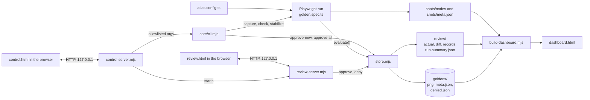

# Architecture

This page explains how the parts of Golden Map Atlas fit together, for people changing the tool. To use it, start with [Getting started](getting-started.md). The full configuration reference is in the root [README](../README.md#config-reference).

## Components

| Component | Files | Role |
|---|---|---|
| CLI | `core/cli.mjs`, `script/*` wrappers, npm scripts in `package.json` | Dispatches every mode. Takes the capture lock, runs Playwright, prints the summary, approves on request |
| Playwright run | `playwright.config.ts`, `core/golden.spec.ts`, `core/global-setup.ts`, `core/atlas.ts`, `core/run-reporter.ts` | One test per node per variant. Captures each shot, compares it with its golden, writes records. `global-setup.ts` waits for `server.ready` and warms the browser |
| Store | `core/store.mjs`, `core/store.d.mts` | Shared review logic: image comparison, status rules, records, approve and deny. The only module that writes approved goldens |
| Review server and UI | `core/review-server.mjs`, `core/review.html` | Local server on `127.0.0.1` (default port 8097). Serves the queue, images and markup diffs, approves and denies, and can start a capture |
| Control server and panel | `core/control-server.mjs`, `core/control.html` | Local server on `127.0.0.1` (default port 8099). Runs `core/cli.mjs` commands from an allowlist, one job at a time, and streams their output |
| Stabilize | `core/stabilize.mjs` | Runs the capture several times into a scratch root and reports the shots that differ between runs |
| Dashboard builder | `core/build-dashboard.mjs`, `core/template.html` | Merges the fragments and records, takes each image from `review/actual/` or `goldens/`, converts screenshots to WebP through headless Chromium, and writes one offline `dashboard.html` |
| Config generator | `core/init.mjs` | Renders `atlas.config.ts` for `init` and `config --answers`. The interactive `config` uses the same template |
| Static server | `core/serve.mjs` | Serves `staticDir` for the capture. No cache headers, no SPA fallback |
| Discover and crawl | `core/discover.spec.ts`, `core/crawl.spec.ts` | Optional Playwright runs, selected with `ATLAS_DISCOVER` and `ATLAS_CRAWL` |
| Tooltips | `core/tooltip.js` | One script for the panel, review and dashboard pages. The two servers serve it, and `build-dashboard.mjs` inlines it into `dashboard.html` |

## How they talk

The arrows show data and calls. The browser pages never touch files. They ask their local server, and the server decides what to read or run.

## Life of one capture run

`npm run capture`, `check` and `atlas` follow the same steps. `stabilize` reuses steps 4 to 7.

1. **The CLI starts.** `cli.mjs` checks the Node version, installs packages and Chromium if they are missing, and stops if `atlas.config.ts` does not exist.
2. **Old output is cleared.** For a full run (no Playwright arguments after `--`), the CLI deletes `shots/nodes`, `review/actual`, `review/diff`, `review/records` and `review/stabilize.json`. A partial run keeps them. Goldens are never touched.
3. **The lock is taken.** The CLI writes `review/.capture.lock` and refuses to start if a live process holds it (see [Capture lock](#capture-lock)).
4. **Playwright starts.** `playwright.config.ts` loads `atlas.config.ts`, starts the app (`server.command`, or the static server for `staticDir`) unless it is already answering, and runs `global-setup.ts`. That waits for `server.ready` if set, then loads `baseURL` once unless `warmup` is `false`.
5. **Each test captures one shot.** `golden.spec.ts` runs one test per node per variant. It fixes the clock (unless `clock` is `false`), writes storage, seeds `Math.random`, opens the chain root, replays the steps of each node down the chain, waits for `ready`, and settles the page. It then takes the full-page shot and each component and collection item. Each shot is retaken until two consecutive takes are byte-identical (`stableShots`). Markup is read for the HTML signal.
6. **The shot is evaluated.** `store.evaluate()` writes the image and markup to `review/actual/`, the pixel diff to `review/diff/` when pixels differ, and one record to `review/records/`. It applies the status rules against the golden. It does not write to `goldens/`.
7. **The test writes its fragment.** It writes `shots/nodes/<variant>/<file>.json` for the dashboard. Unless `ATLAS_STABILIZE` is set, a test whose shots are not `match` or `volatile` fails with `visual check failed`, and that message is kept so a retry fails with the same text.
8. **The reporter summarises.** `run-reporter.ts` writes `review/run-summary.json`: failures by class, flaky tests and warnings.
9. **The CLI reads the records back.** It prints the summary. `check` exits 1 unless every record is `match` or `volatile`. The first capture, when no goldens exist, also runs `stabilize` with two more runs.
10. **The dashboard is built (`atlas` only).** `build-dashboard.mjs` reads the fragments, records and images, and writes `dashboard.html`. `atlas` then opens it.

## Why capture never writes goldens

A capture measures the app. It does not decide whether a difference is a bug or an intended change. If a capture wrote goldens, every run would accept its own output and a regression would pass silently.

So goldens change in two places only:

- `store.approve()` writes `goldens/<variant>/<file>.png` and `<file>.meta.json`. The review server calls it for one record at a time, and `approve-new` and `approve-all` call it in bulk.
- `store.deny()` writes `goldens/denied.json`. The golden itself stays as it was.

`golden.spec.ts` only calls `evaluate()`, which writes under `review/` and `shots/`. The bootstrap `stabilize` runs in a scratch root with no goldens, so it cannot change them either. The approval commands also refuse to run when a guard fails (see [Approval guards](../README.md#approval-guards) in the root README).

## Two run roots: PROJECT_ROOT and ATLAS_ROOT

There are two roots, and they serve different purposes.

- **PROJECT_ROOT** is the folder above `core/`. `atlas.config.ts` and `atlas.crawl.json` are always read from here. `core/atlas.ts` sets it from its own location and ignores `ATLAS_ROOT`.
- **ATLAS_ROOT** is where `goldens/`, `review/`, `shots/` and `test-results/` live. It defaults to PROJECT_ROOT. `core/atlas.ts`, `core/store.mjs` and `core/control-server.mjs` read it when they load.

`stabilize` uses the second root to run the capture side by side without touching the real output. For each run `i`, it runs `npx playwright test` with `ATLAS_ROOT=<project>/.stabilize/run-<i>` and `ATLAS_STABILIZE=1`. Each scratch root has an empty `goldens/`, so every settled shot records as `new` and is compared with nothing approved. The runs are compared with each other instead. The records of each run come from its own `review/records`. The report goes to the real `review/stabilize.json`, because the stabilize process does not set `ATLAS_ROOT` itself. The scratch folder is deleted unless `--keep` is given.

Two rules follow from this:

- A process reads `ATLAS_ROOT` once, when its modules load. Setting it in a shell moves the output of every tool started from that shell.
- `build-dashboard.mjs` takes its root from its own location and does not read `ATLAS_ROOT`. The CLI uses its own folder for `atlas.config.ts` and `dashboard.html`. Only `stabilize` should set `ATLAS_ROOT`.

## Environment variables

| Variable | Set by | Read by | Effect |
|---|---|---|---|
| `ATLAS_ROOT` | You, or `stabilize.mjs` for each scratch run | `core/atlas.ts`, `core/store.mjs`, `core/control-server.mjs` | Moves `goldens/`, `review/`, `shots/` and `test-results/` to another folder. `build-dashboard.mjs` ignores it |
| `ATLAS_CRAWL` | `cli.mjs` `crawl` | `playwright.config.ts` | Runs only the `crawl` project, with no retries, and does not write `run-summary.json` |
| `ATLAS_DISCOVER` | `cli.mjs` `discover` | `playwright.config.ts` | Runs only the `discover` project, with no retries, and does not write `run-summary.json` |
| `ATLAS_STABILIZE` | `core/stabilize.mjs` for each run | `playwright.config.ts`, `core/golden.spec.ts` | Sets the line reporter and the run reporter, puts `test-results/` under `ATLAS_ROOT`, and turns off retries. `golden.spec.ts` then skips the visual check and writes no visual-failure marker |
| `ATLAS_PANEL_URL` | `control-server.mjs`, for every job it starts | `core/build-dashboard.mjs` | The address the dashboard links back to. Defaults to `http://127.0.0.1:8099/` |

## Capture lock

`review/.capture.lock` holds `{ "pid", "startedAt" }` while a capture runs. Three things take it: `cli.mjs` for `capture`, `check`, `atlas` and `stabilize`, and the review server for the **Run capture** button.

A lock is live when its process still exists (`process.kill(pid, 0)`; a permission error counts as live). A lock whose process is gone is stale and is overwritten. The CLI removes its lock on exit, and the review server removes its lock when the run ends.

`approve-new` and `approve-all` do not take the lock. The control panel runs one job at a time, but the lock is what stops a CLI run and a review-server run from overlapping.

## The config hash

Each shot has a config hash. It is stored in `goldens/<variant>/<file>.meta.json` when the shot is approved, and it is compared with the current hash on every run. A different hash makes the shot `stale` (when its pixels still match) or `changed` (when they do not). A denial also records the hash, so an old denial does not apply after a config change.

The hash is computed in `core/golden.spec.ts` as `sha256(stable({ shared, extra }))`:

- `shared.node`: the whole node object, not only the fields the root README lists. That includes `steps`, `components`, `collection`, `mask`, `hashInput`, `ready`, `label`, `kind`, `tags` and `group`.
- `shared.ancestors`: the nodes above it in its chain.
- `shared.fixture`: the resolved fixture of the chain root (its storage, cookies and `prepare` hook).
- `shared.variant`: the whole variant object, including its `label`, `colorScheme`, viewport, storage and `prepare` hook.
- `shared.global`: `mask`, `freezeCss`, `freezeCanvas`, `theme`, `clock`, `seedRandom` and `settle`.
- `extra`: what is particular to this shot, such as the component or the collection item.

Values are serialised with sorted keys. Functions are hashed by their `src` tag when they have one (the step helpers) and by their source text otherwise.

**Why an unset option does not change the hash.** `stable()` uses `JSON.stringify`, which drops keys whose value is `undefined`. A config that does not set an option therefore hashes exactly as it did before the option existed. The hash takes the raw config value, and the reader applies the default afterwards. `golden.spec.ts` shows the split: `CANVAS = config.freezeCanvas ?? 'mask'` drives behaviour, while `global.freezeCanvas: config.freezeCanvas` goes into the hash unchanged.

**What this means in practice.** Writing a default out explicitly changes the hash, even though the behaviour is the same. `freezeCanvas: 'mask'`, `seedRandom: true` or `clock: '2026-01-01T12:00:00Z'` each make every shot `stale`. Removing them makes the shots match again.

**Not in the hash.** Changing these does not make a golden stale: `review.*`, `stableShots`, `retries`, `timeout`, `actionTimeout`, `workers`, `warmup`, `server`, `baseURL`, `root`, `groups`, `labels`, `textSelectors` and `crawl`. Only the global fields listed above count.

**Steps.** A step helper such as `click("#a")` carries its arguments in its `src`, so changing a selector or a value changes the hash. A hand-written `steps` function is hashed by its source text. A change to a variable it closes over does not change the text, so the hash does not change either. See [Decisions and config changes](../README.md#decisions-and-config-changes).

## Module boundaries

- `core/` is generic. App knowledge belongs in `atlas.config.ts`.
- Only `core/store.mjs` writes approved goldens.
- The control server builds every command's argv from its own allowlist, and the browser never sends argv or a command. See [Contributing](contributing.md#invariants) for the exceptions that pass text through a shell.
